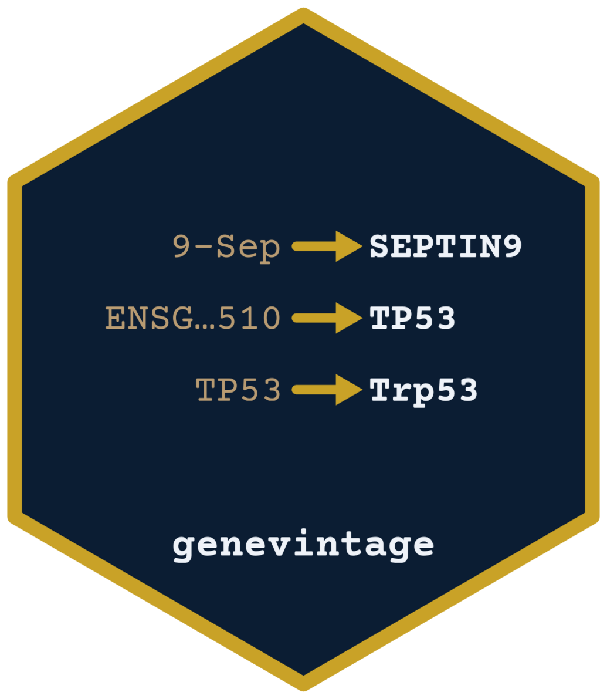

# genevintage 

[](https://github.com/saketlab/genevintage/actions/workflows/R-CMD-check.yaml)

`genevintage` finds the species and the Ensembl or GENCODE release of a list of
gene IDs. It also changes the gene IDs to gene names.

```r
ids <- c("ENSG00000141510.16", "ENSG00000284733", "ENSG00000012048")
```

`DetectRelease()` ranks the releases that fit the IDs:

```r
head(DetectRelease(ids), 3)
#>        species  source release assembly feasible   dist n_index
#> 1 homo_sapiens gencode      26       38     TRUE 9.6486   58219
#> 2 homo_sapiens gencode      27       38     TRUE 9.6505   58288
#> 3 homo_sapiens gencode      28       38     TRUE 9.6534   58381
```

`GeneID2Name()` detects the release and returns the names:

```r
GeneID2Name(ids)
#> Best fingerprint match: homo_sapiens, gencode release 26 (assembly 38) -- 79 candidates score within 10%
#> [1] "TP53"            "ENSG00000284733" "BRCA1"
```

## Fix gene names that Excel changed

Excel turns some gene symbols into dates: `SEPT9` becomes `9-Sep` and `DEC1`
becomes `1-Dec`. `CorrectGeneNames()` maps them back using the symbols of the
release you pick:

```r
x <- c("9-Sep", "1-Dec", "2-Mar", "TP53")
fixed <- CorrectGeneNames(x, species = "human", release = 116)
#> homo_sapiens, ensembl release 116
#> repaired 2 of 3 damaged names.
#> Warning message:
#> 1 token(s) match more than one symbol and were left alone, e.g. 2-Mar.
as.vector(fixed)
#> [1] "SEPTIN9" "DELEC1"  "2-Mar"   "TP53"
```

With `release = 95` you get `SEPT9` and `DEC1` instead.

A token changes only when exactly one symbol fits. `2-Mar` could be `MARCHF2` or
`MTARC2`, so it is left as is and listed in `attr(fixed, "ambiguous")`.

On a count matrix it fixes the row names:

```r
m <- matrix(1:6, nrow = 3, dimnames = list(c("9-Sep", "1-Dec", "TP53"), c("s1", "s2")))
CorrectGeneNames(m, species = "human", release = 116)
#> homo_sapiens, ensembl release 116
#> repaired 2 of 2 damaged names.
#>         s1 s2
#> SEPTIN9  1  4
#> DELEC1   2  5
#> TP53     3  6
```

## Other functions

```r
GeneIDs(c("TP53", "BRCA1"), species = "human")   # names to IDs
AnnotateGenes(ids)                               # symbol, biotype and coordinates
MitoGenes(species = "human")
RibosomalGenes(species = "human")
SexGenes(species = "chicken", which = "W")       # birds have Z/W
GenesByBiotype("lncRNA", species = "mouse")
CompareReleases("human", from = 110, to = 116)   # added, removed and renamed genes
Orthologs(ids, to = "mouse")
```

`GeneID2Name()` also takes a matrix and renames its rows.

Every function has a snake_case twin: `GeneID2Name()` is `geneid2name()`.

## Install

```r
# install.packages("remotes")
remotes::install_github("saketlab/genevintage", subdir = "R")
```
