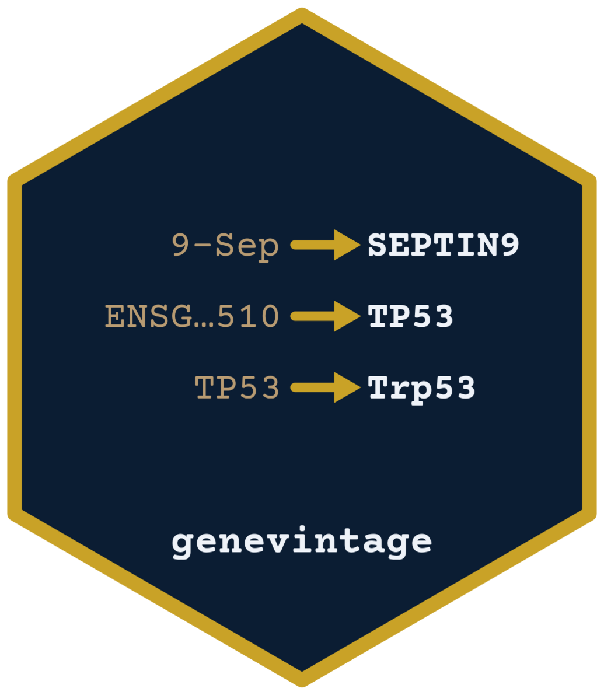

# genevintage

`genevintage` finds the species and the Ensembl or GENCODE release of a vector of
gene IDs and converts them to gene names. It also repairs gene names that Excel
turned into dates.

| Client | Status | Path |
|---|---|---|
| R | available | [`R/`](R/) |

Docs: <https://genevintage.saketlab.org/R/>

## R

```r
# install.packages("remotes")
remotes::install_github("saketlab/genevintage", subdir = "R")
```

```r
library(genevintage)
ids <- c("ENSG00000141510.16", "ENSG00000284733", "ENSG00000012048")

detect_release(ids)          # ranked releases, Ensembl and GENCODE
#>        species  source release assembly feasible   dist n_index
#> 1 homo_sapiens gencode      26       38     TRUE 9.6486   58219

geneid2name(ids)             # detect + map in one step
#> [1] "TP53"            "ENSG00000284733" "BRCA1"
```

### Fix gene names that Excel changed

Spreadsheet software like Excel can turn genes like `SEPT9` into `9-Sep`. 
`correct_genenames()` fixes this:

```r
x <- c("9-Sep", "1-Dec", "2-Mar", "TP53")
as.vector(correct_genenames(x, species = "human", release = 116))
#> [1] "SEPTIN9" "DELEC1"  "2-Mar"   "TP53"
```

Other functions: gene classes (`mito_genes()`, `sex_genes()`, `coding_genes()`,
`ribosomal_genes()`, `lncrna_genes()`), `orthologs()`, `compare_releases()` and
`annotate_genes()`. Refer to the [documentation](https://genevintage.saketlab.org/R/).

## License

MIT
